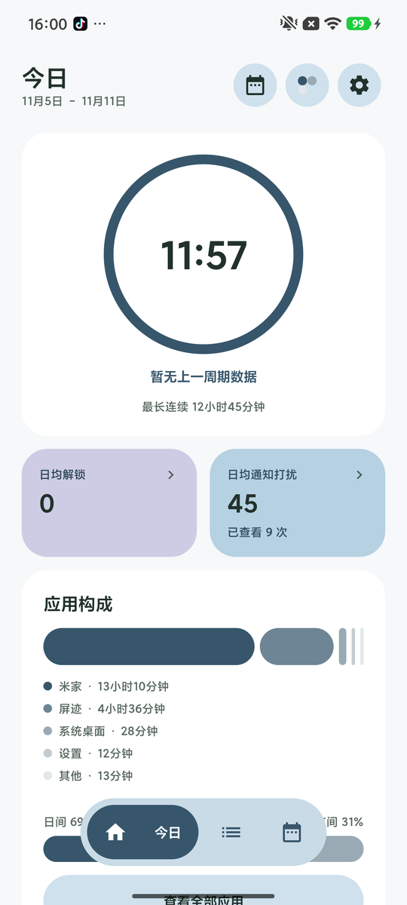
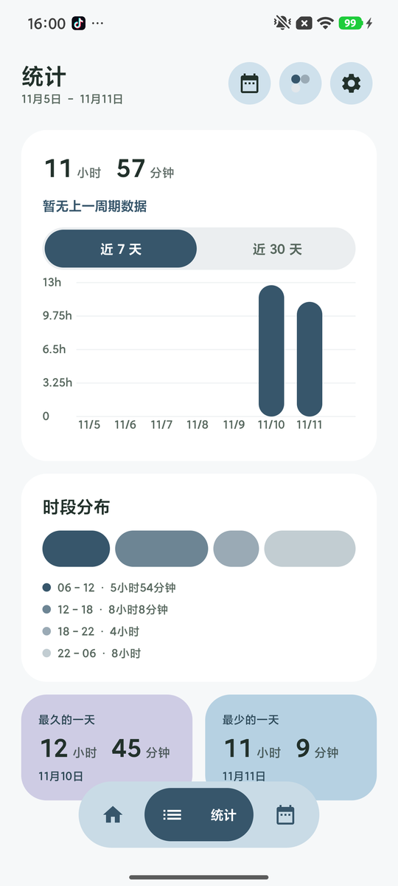
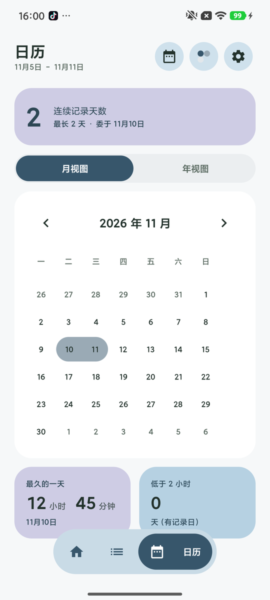

<div align="center">

# 屏迹 · ScreenTrace

**把 Android 的屏幕使用时间，还给自己**

本地统计 · 无需账号 · 无广告 · 不联网也能用

[](https://developer.android.com)
[](https://kotlinlang.org)
[](https://developer.android.com/jetpack/compose)
[](LICENSE)
[](https://github.com/Sunbeam-5/ScreenTrace/stargazers)

<p align="center">
  
  
  
</p>

</div>

## 简介

屏迹是一款 Android 屏幕使用时间统计应用。它通过 [Shizuku](https://shizuku.rikka.app/) 读取系统的
`usagestats` 数据，在本地解析、逐日累积，并把结果画成能看懂的样子：今天用了多久、一周的趋势、
哪几天用得特别多、时间都花在哪些应用上。

所有数据只存在你自己的手机上，没有账号、没有云端、没有广告和统计 SDK。系统自带的屏幕时间管理
在部分机型上只能看最近几天，甚至会因为事件缓冲过期而越看越少——屏迹的做法是把每次看到的亮屏
区间都记下来做并集，用得越久越准。

## 功能

- **今日概览** —— 日均使用时长圆环、解锁次数、通知打扰、应用构成与日间/夜间比例
- **趋势统计** —— 近 7 天 / 近 30 天柱状图、时段分布、最久与最少的一天、对比上一周期
- **日历热力图** —— 月视图与年视图，连续记录天数，「低于 x 小时」的天数可自定义阈值
- **下钻明细** —— 解锁次数、通知打扰都有独立的图表 + 数据表
- **应用排行** —— 按使用时长排序，真实图标、分类构成与占比
- **九套主题 × 深浅色** —— 支持跟随系统与壁纸取色
- **数据自持** —— 本地 Room 库，按日增量累积；云同步与导出在规划中

## 安装

目前没有发布正式版本，可以从源码构建，或关注 [Releases](https://github.com/Sunbeam-5/ScreenTrace/releases)。

首次启动需要安装并授权 Shizuku（未授权时会降级到系统的 `UsageStatsManager`，只有应用级数据，
界面上会明确标注降级状态）。系统要求 **Android 8.0（API 26）及以上**。

## 从源码构建

需要 JDK 17 与 Android SDK Platform 34：

```bash
git clone git@github.com:Sunbeam-5/ScreenTrace.git
cd ScreenTrace
./gradlew :app:assembleDebug
adb install -r app/build/outputs/apk/debug/app-debug.apk
```

跑单元测试（174 个 JVM 用例，不需要真机）：

```bash
./gradlew :app:testDebugUnitTest
```

首次 Sync 的常见坑（SDK 版本、Gradle 镜像、JDK 21 与 `jvmTarget` 的关系）见
[开发与构建说明](docs/开发与构建说明.md)。

## 关于数据

- **来源**：Shizuku 执行 `dumpsys usagestats`，解析 checkin 与明文两种格式；降级通道为 `UsageStatsManager`。
- **各机型历史窗口不同**：有的系统只暴露最近约 2 天的按日统计，所以屏迹采用每日拉取自建历史库。
- **事件缓冲会过期**：屏幕会话按区间入库并跨拉取取并集，任何一次见过的时段都计入，只增不减。
- **「—」不是 0**：系统没有上报解锁事件时显示 `—`，与真实 0 次区分开；设备开了「不灭屏」时 0 是真实值。
- **应用时长之和可能大于总时长**：含前台服务、画中画与并行窗口。

更多口径与设计取舍见 [需求文档](docs/需求文档-屏幕使用时间App.md)。

## 文档

- [需求文档](docs/需求文档-屏幕使用时间App.md)（v2.6）—— 数据口径、UI 规范、验收标准
- [实施任务批次计划](docs/实施任务批次计划-v2.md) —— 开发进度与批次划分
- [开发与构建说明](docs/开发与构建说明.md) —— 环境、构建、常见故障

## 致谢

- [Shizuku](https://github.com/RikkaApps/Shizuku) —— 免 root 访问系统数据
- [nsh07/Tomato](https://github.com/nsh07/Tomato) 与 fushi —— 界面与交互上的参考（仅参考设计，未复制源码）
- [Jetpack Compose](https://developer.android.com/jetpack/compose)、[Room](https://developer.android.com/training/data-storage/room)、[Robolectric](https://robolectric.org/) —— 基础设施与测试

## 声明

- 本应用不收集、不上传任何使用数据；除用户主动开启的云同步与 AI 分析外不联网。
- 统计结果仅供参考，不构成健康、医疗或行为建议。
- 使用 Shizuku 授权的权限由系统与 Shizuku 共同管理，应用本身不申请 root。

## License

[Apache License 2.0](LICENSE) © 2026 Sunbeam-5
